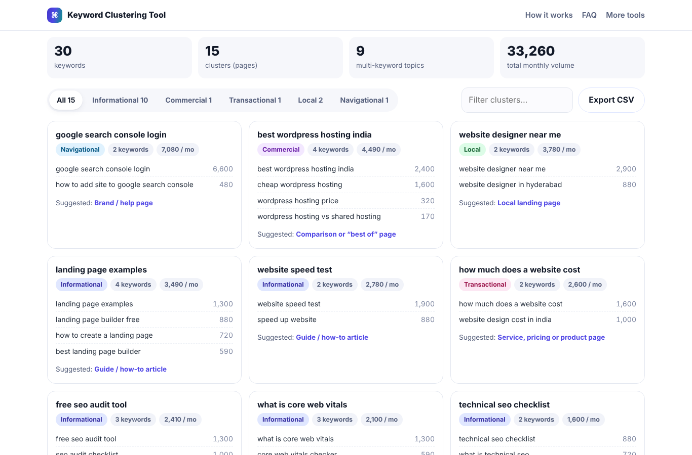

# Keyword Clustering Tool

Group up to 5,000 keywords into topics, tag search intent and plan one page per cluster.

**Live demo:** https://harikabehara247.github.io/keyword-cluster-tool/

## Features

- Paste keywords with optional search volume (comma or tab separated)
- Groups keywords by shared meaningful words with light stemming, so word forms match
- Adjustable grouping strictness
- Search intent tags: informational, commercial, transactional, local (incl. Indian cities) and navigational
- Suggested page type for every cluster
- Filter by intent, search clusters, export everything to CSV
- 100% client-side

## How to use

Paste one keyword per line, optionally followed by a comma and the monthly volume. Click **Cluster keywords**, then adjust the strictness slider until the groups look like individual pages.

## Run it yourself

It is a single, dependency-free HTML file. Download `index.html` and open it in any modern browser, or host it on GitHub Pages, Netlify or your own site.

## Good to know

Clustering is based on word overlap, not live Google results. For your most valuable clusters, confirm by checking whether the same pages rank for the grouped keywords.

## About

Built by **[Harika Behara](https://github.com/harikabehara247)** — a single-file, privacy-friendly tool for website owners and SEO professionals.

Issues and suggestions are welcome: open an issue on this repository.

## Licence

[MIT](LICENSE) © 2026 Harika Behara
